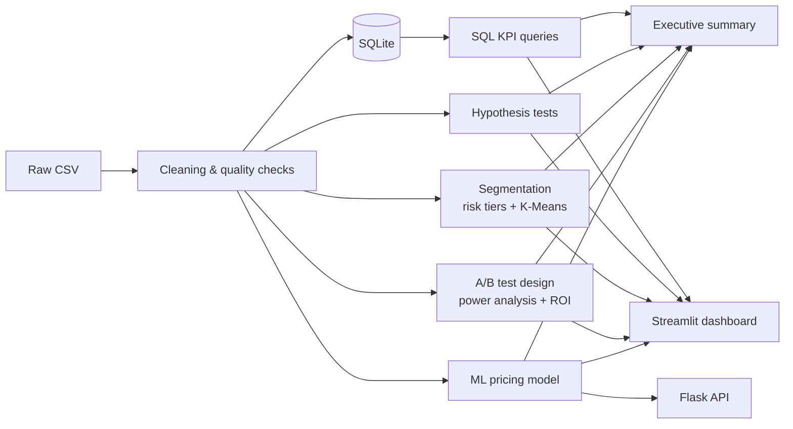
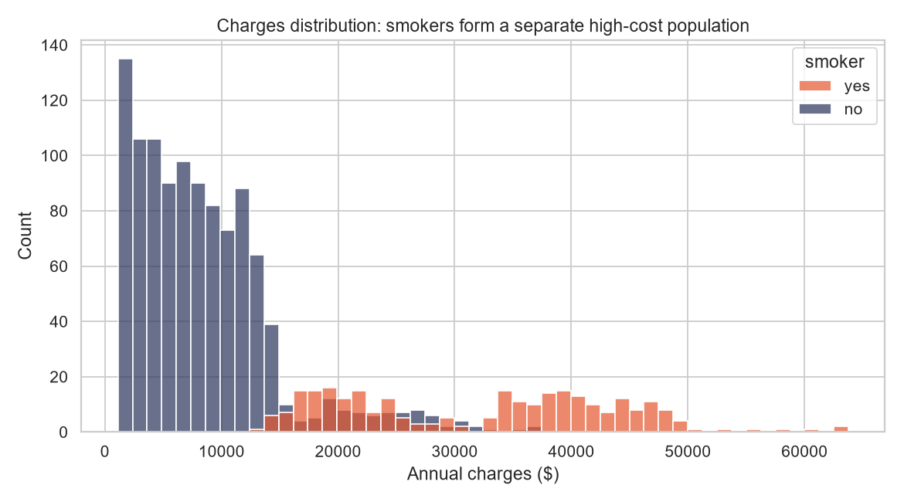
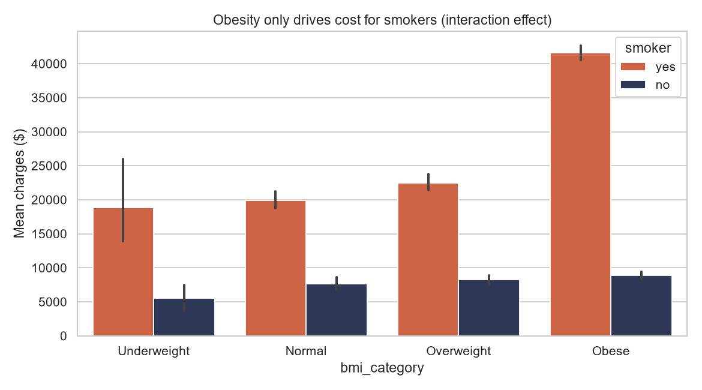
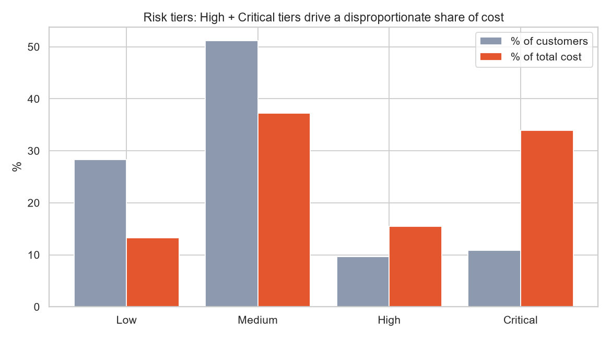
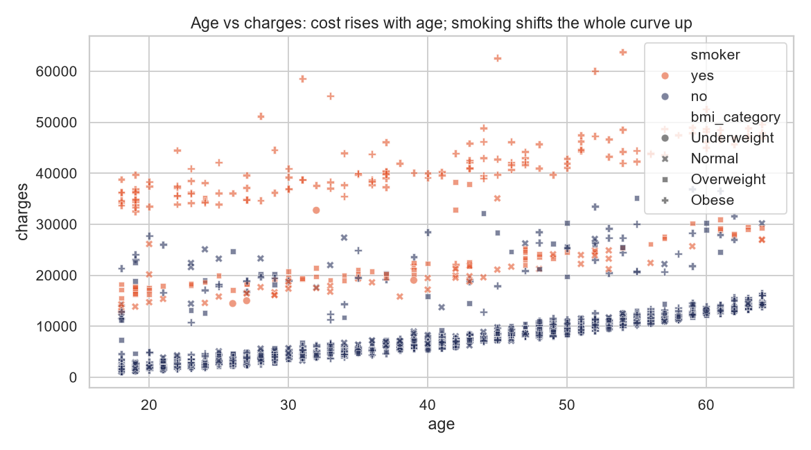
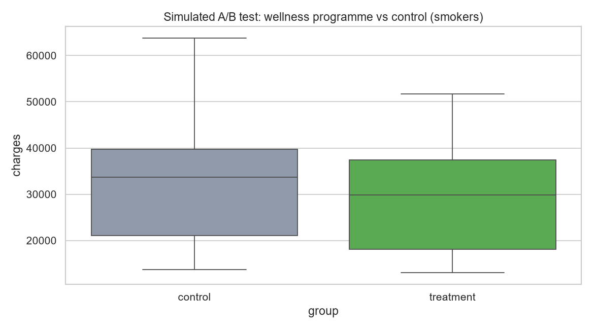
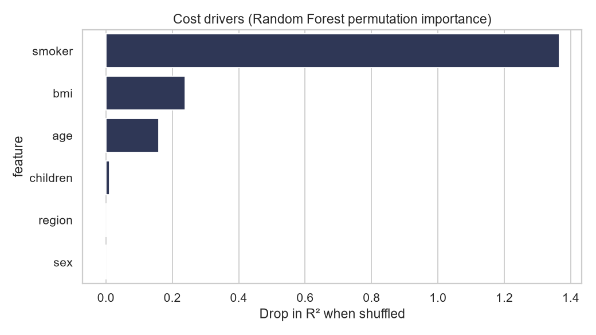

# 📊 Health Insurance Cost Analytics: Drivers, Segmentation, Pricing Model

An end-to-end **data analytics case study** that answers a real business question for an insurer:

> **Who are our costliest policyholders, why do they cost more, and what should we do about it?**

It goes from raw data to **SQL KPIs → statistical testing → customer segmentation → ML pricing model → interactive dashboard → executive recommendations**.

📄 **[Read the Executive Summary (INSIGHTS.md)](reports/INSIGHTS.md)**: every number in it is generated by the code.

---

## 🔑 Headline insights
<!-- Numbers below are from reports/INSIGHTS.md (auto-generated by run_analysis.py) -->

1. **Smoking is the #1 cost driver.** Smokers cost **3.8x** more ($32,050 vs $8,441; p < 0.001, Cohen's d = 3.16). They are **20% of customers but 50% of total cost**.
2. **Obesity raises cost mainly for smokers (interaction effect).** Obese smokers cost **+$20,195** more than non-obese smokers, versus only **+$879** among non-smokers, so a blanket BMI surcharge would be poorly targeted.
3. **Cost is concentrated.** The top 10% of policyholders generate **32%** of total cost and the top 20% generate **52%** (Pareto analysis in SQL with window functions).
4. **Age drives cost for non-smokers** (r = 0.63). Sex and region have negligible practical effect, so they are poor pricing levers.
5. **Pricing model:** Random Forest with **hold-out R² = 0.896** and **MAE = $2,444**. The top drivers (smoker, BMI, age) match the hypothesis tests.

---

## 🧭 Project workflow



| Step | What was done | Skills |
|---|---|---|
| **1. Data cleaning** | Data-quality report, removed duplicate rows (2,772 → ~1,337 unique), validated ranges, engineered BMI category / age group / risk tier | Python, Pandas |
| **2. SQL analysis** | 8 KPI queries: segment cost share, region × smoker matrix, **Pareto deciles with window functions (`NTILE`, running `SUM OVER`)** | SQL (SQLite) |
| **3. EDA & visualisation** | Distributions, interaction plots, heatmaps, correlation | Matplotlib, Seaborn, Plotly |
| **4. Hypothesis testing** | Welch t-test, Mann-Whitney U, ANOVA, Kruskal-Wallis, Chi-square, Pearson/Spearman, with **effect sizes** (Cohen's d, η², Cramér's V) and **95% CIs** | SciPy, statistics |
| **5. Segmentation** | Rule-based risk tiers (cost share vs customer share) + K-Means personas (silhouette-based k selection) | Scikit-learn |
| **6. A/B testing** | Wellness-programme experiment: power analysis → randomised simulation → Welch test → guardrail metric → ROI-based go/no-go | Statsmodels, experiment design |
| **7. ML pricing model** | Linear / Ridge / Random Forest / Gradient Boosting compared with 5-fold CV; permutation importance; deployed as a single sklearn `Pipeline` | Scikit-learn |
| **8. Communication** | Auto-generated executive summary + interactive dashboard + REST API | Streamlit, Flask |

---

## 📈 Visuals

| | |
|---|---|
|  |  |
|  |  |
|  |  |

---

## 🗂️ Project structure

```
├── dataset/medical_insurance.csv     # raw data
├── sql/kpi_queries.sql               # business KPI queries (named, runnable)
├── src/
│   ├── data_prep.py                  # cleaning, quality report, feature engineering
│   ├── sql_analysis.py               # SQLite loader + query runner
│   ├── stats_tests.py                # hypothesis tests + effect sizes
│   ├── segmentation.py               # risk tiers + K-Means
│   ├── ab_test.py                    # power analysis, simulation, ROI decision
│   └── modeling.py                   # ML model comparison & pipeline
├── run_analysis.py                   # ▶ one command reproduces everything
├── dashboard.py                      # ▶ Streamlit dashboard
├── app.py                            # Flask prediction API (+ templates/, static/)
├── reports/
│   ├── INSIGHTS.md                   # executive summary & recommendations
│   ├── results.json                  # all metrics
│   ├── sql_outputs/*.csv             # KPI query results
│   └── figures/*.png
├── models/Health_Cost_Prediction.ipynb  # original exploratory notebook
└── tests/                            # pytest suite (analytics + API)
```

---

## 🚀 Run it

```bash
pip install -r requirements.txt

python run_analysis.py          # cleans data, runs SQL/stats/segments/A-B/model, writes reports/
streamlit run dashboard.py      # interactive dashboard
python app.py                   # Flask API at http://127.0.0.1:5000
pytest -q                       # run test suite
```

**API example**

```bash
curl -X POST http://127.0.0.1:5000/predict -H "Content-Type: application/json" \
     -d '{"age":40,"sex":"male","bmi":31,"children":2,"smoker":"yes","region":"southeast"}'
```

---

## ⚠️ Notes & limitations
- The dataset is observational, so the analysis shows **association, not causation**.
- **A/B outcomes are simulated** from the real smoker cost distribution with an assumed effect; the deliverable is the experiment design and decision framework.
- About half of the raw file is exact duplicate rows; these are removed before every analysis.

## 💻 Tech stack
Python · Pandas · NumPy · SQL (SQLite) · SciPy · Statsmodels · Scikit-learn · Matplotlib · Seaborn · Plotly · Streamlit · Flask · Pytest

## 📬 Contact
**Rajveer Pathak** · 📧 [tarupa123@gmail.com](mailto:tarupa123@gmail.com) · [LinkedIn](https://www.linkedin.com/in/rajveerpathak/) · [GitHub](https://github.com/rajveerpathak1)
